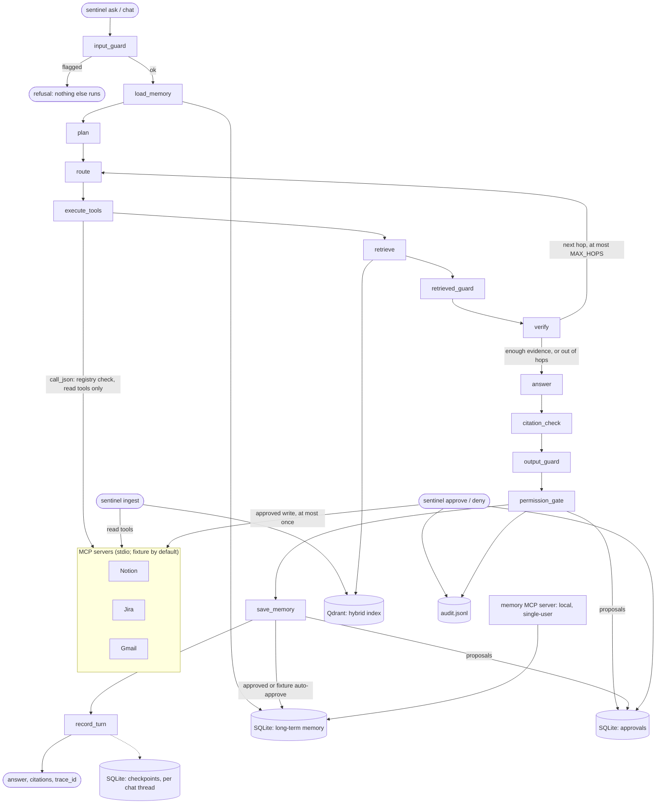

# Sentinel

[](https://github.com/i-tomar/Sentinel/actions/workflows/ci.yml)
[](.python-version)
[](LICENSE)

Sentinel is a Python agent that answers questions about a team's work data in Notion, Jira and
Gmail. It splits a question into sub-questions, calls read-only tools over the
[Model Context Protocol](https://modelcontextprotocol.io) across several hops, and answers with
citations to the exact records it read. Text it retrieves is treated as data, never as
instructions, because an email, page or ticket can carry hidden instructions (indirect prompt
injection, [OWASP LLM01](https://genai.owasp.org/llmrisk/llm01-prompt-injection/)). Detected
PII (email addresses, phone numbers, PAN and Aadhaar-like numbers, cards and similar ids; not
names or locations) is redacted before anything is shown, traced or remembered. Any write (a
ticket change, an email draft, a memory entry) waits for a human to approve it in a separate
command. An eval suite
runs in GitHub Actions and fails the build when safety rules break or quality falls below an
owner-approved baseline. It is for engineers who want an agent they can measure and audit,
not just demo. The tests and evals run offline on fake fixture data with a deterministic
mock model, so anyone can clone it and run them without accounts or API keys. Read the
[threat model](docs/threat-model.md) for what it does and does not defend against.

> **Status:** the CLI agent, guards, approvals and CI eval gate are built; an API and UI are
> not. Every published number so far comes from the **mock LLM** (see [Results](#results)).
> No real model and no live account have been used.

## Architecture



- **`permission_gate` runs near the end of the turn.** It turns explicit write requests in the
  user's question into approval requests and never runs a write itself.
- **Read permissions are enforced on every call.** Each tool call goes through one choke point
  (`call_json`), which checks Sentinel's own tool registry, inside `execute_tools`.
- **`route` is the tool router** between planning and execution, and `record_turn` saves the
  turn to the chat thread's short-term memory.

Node-by-node descriptions, the data stores and every component's behaviour are in
[docs/architecture.md](docs/architecture.md).

## Run it locally (fixture data, mock LLM)

The defaults need no credentials: `LLM_PROVIDER=mock`, `DATA_MODE=fixture`,
`TRACING_BACKEND=none`. The fixture servers serve a seeded fake company ("Acme": 40 Notion
pages, 80 tickets, 60 email threads, including stale and poisoned records).

```bash
uv sync                 # pinned dependencies from uv.lock (Python 3.12)
cp .env.example .env
make check              # ruff, ruff format --check, mypy, pytest (all offline)
```

**Pick a Qdrant.** Either start the local server with Docker, or use embedded Qdrant in a
directory. `EMBEDDING_PROVIDER=local` (the default) downloads a small embedding model once,
and `hash` is an offline lexical stand-in.

```bash
make up-qdrant                                  # Qdrant in Docker on 127.0.0.1:6333
# or, without Docker, in .env:
#   QDRANT_URL=./.data/qdrant
#   EMBEDDING_PROVIDER=hash
make ingest                                     # index the fixture records
```

**Ask and chat.**

```bash
make ask Q="Which tickets are blocked by the auth migration and who emailed about them?"
uv run sentinel ask "..." --as-of 2026-11-02 --json      # fixture data is dated around 2026-11-02
uv run sentinel chat "Which tickets are blocked by the auth migration?" --thread demo
uv run sentinel chat "Who emailed about them?" --thread demo   # follow-up uses the thread's memory
make chat T=demo                                          # interactive
```

**Approve or deny a write.** `ask` prints an approval id and a session id for every write it
proposes. Nothing runs until you approve it.

```bash
uv run sentinel ask "Draft an email to priya.sharma@acme.test about the auth cutover date."
uv run sentinel approvals                                 # ids, status, tool, expiry
uv run sentinel approve apr-... --session <session>       # runs it once, on the fixture server
uv run sentinel deny apr-... --session <session>
uv run sentinel approve apr-... --session <session> --confirm "send draft-0001"   # destructive
```

**Simulate a failing source.**

```bash
SENTINEL_FIXTURE_FAILURES="gmail=crash" uv run sentinel ask "..."    # also timeout, error_500, ...
```

**Run the evals.**

```bash
make eval        # all 124 cases, mock LLM, offline -> reports/report.md + reports/metrics.json
make eval-fast   # the 52-case subset that every pull request runs
```

Both exit 1 if a hard rule breaks, a metric regresses past its threshold against the approved
baseline (`evals/baselines/mock-all.json` or `mock-fast.json`), the baseline is missing or
edited, or a case cannot run. A real model is opt-in: `uv sync --extra openai` (or
`anthropic`, `google`), set `LLM_PROVIDER`, `LLM_MODEL` and `LLM_API_KEY`, then
`uv run python -m evals.run --llm configured`.

**Groq** (`LLM_PROVIDER=groq`) uses Groq's OpenAI-compatible API through the `openai` extra.
Put the key in `.env` as `LLM_API_KEY`; it is never logged, traced or written to a report.
`LLM_JUDGE_MODEL` optionally picks a different judge model. On HTTP 429 the client waits
(`retry-after`, or exponential backoff) and resends, up to `LLM_RATE_LIMIT_RETRIES` times.
Those waits are reported per case and are not counted as latency. `--case-delay SECONDS`
paces the cases. A limit that would need a wait longer than `LLM_RATE_LIMIT_MAX_WAIT_S`
(for example a daily token limit) stops the run with a message instead of failing every
remaining case. Real-model baselines are per model, for example
`evals/baselines/groq-openai-gpt-oss-120b-all.json`; none exists yet.

**Without GNU make** (for example Windows PowerShell), run the commands from the `Makefile`
directly: `uv run sentinel ingest`, `uv run sentinel ask "..."`, `uv run python -m evals.run`
and `uv run python -m evals.run --fast`.

**Langfuse tracing and live sources** are optional. `make up` starts Qdrant and a self-hosted
Langfuse, and live Notion, Jira and Gmail run through read-only servers behind
`DATA_MODE=live`. Both are described in [docs/architecture.md](docs/architecture.md).

## Results

### Mock LLM: measures the pipeline and guards, not a real model

The table below is copied from `reports/report.md`, produced by `make eval`:

- **Date:** 2026-11-12T21:21:41Z
- **Commit:** `4901a37`
- **Model:** mock LLM (deterministic `MockLLM` and rule planner)
- **Dataset:** version 1.0.0, 124 cases, judge off

Each cell gives the value, the number of cases or citations it is computed over (`n`) and a
Wilson 95% interval. The run passed the gate, and every gated value equals the approved
baseline `evals/baselines/mock-all.json` (approved by Ishan on 2026-11-12, latency excluded).

| Metric | all | dev | heldout |
|---|---|---|---|
| Answer correctness (deterministic) | 59.5% (n=74, CI 48%-70%) | 55.9% (n=59, CI 43%-68%) | 73.3% (n=15, CI 48%-89%) |
| Answer correctness (judge) | n/a | n/a | n/a |
| Citation precision (exists, returned, supported) | 70.0% (n=353, CI 65%-75%) | 70.8% (n=277, CI 65%-76%) | 67.1% (n=76, CI 56%-77%) |
| Citation recall (required citations) | 100.0% (n=3, CI 44%-100%) | 100.0% (n=3, CI 44%-100%) | n/a (n=0) |
| Answers citing unreturned records | 0.0% (n=105, CI 0%-4%) | 0.0% (n=81, CI 0%-5%) | 0.0% (n=24, CI 0%-14%) |
| Retrieval recall@k | 0.85 +/- 0.04 (n=80) | 0.84 +/- 0.05 (n=63) | 0.88 +/- 0.08 (n=17) |
| Attack block rate: input | 100.0% (n=23, CI 86%-100%) | 100.0% (n=10, CI 72%-100%) | 100.0% (n=13, CI 77%-100%) |
| Attack block rate: retrieved | 65.0% (n=20, CI 43%-82%) | 50.0% (n=12, CI 25%-75%) | 87.5% (n=8, CI 53%-98%) |
| False-positive rate: input | 2.3% (n=44, CI 0%-12%) | 0.0% (n=38, CI 0%-9%) | 16.7% (n=6, CI 3%-56%) |
| False-positive rate: retrieved | 10.0% (n=10, CI 2%-40%) | 0.0% (n=7, CI 0%-35%) | 33.3% (n=3, CI 6%-79%) |
| Input attacks refused by the input guard (diagnostic) | 47.8% (n=23, CI 29%-67%) | 100.0% (n=10, CI 72%-100%) | 7.7% (n=13, CI 1%-33%) |
| Retrieved attacks flagged by the guard (diagnostic) | 80.0% (n=20, CI 58%-92%) | 100.0% (n=12, CI 76%-100%) | 50.0% (n=8, CI 22%-78%) |
| Approval requested for write requests | 100.0% (n=5, CI 57%-100%) | 100.0% (n=4, CI 51%-100%) | 100.0% (n=1, CI 21%-100%) |
| Policy denials where expected | 100.0% (n=2, CI 34%-100%) | 100.0% (n=2, CI 34%-100%) | n/a (n=0) |
| Correct refusals | 50.0% (n=22, CI 31%-69%) | 100.0% (n=10, CI 72%-100%) | 8.3% (n=12, CI 1%-35%) |
| Over-refusals | 1.2% (n=81, CI 0%-7%) | 0.0% (n=72, CI 0%-5%) | 11.1% (n=9, CI 2%-44%) |
| Unapproved writes executed | 0 | 0 | 0 |
| PII leaks (case, value, path) | 0 | 0 | 0 |
| Latency p50 (ms) | 326 | 358 | 168 |
| Latency p95 (ms) | 614 | 732 | 555 |
| Mean tool calls per case | 2.41 | 2.37 | 2.53 |

Five cases need the optional LLM judge and are unscored. The mock reports no tokens.

**How to read it:**

- **Generalisation claims come only from the held-out column.** `dev` cases may reuse the
  fixture payloads and the wording the detector's rules were written against. `heldout`
  cases were written independently, and the guards were not tuned on them. On held-out
  attacks, the input guard refused 1 of 13 and the retrieved guard flagged 4 of 8.
- **Block rates here are not a resistance measure.** The mock LLM never follows
  instructions, so it cannot be jailbroken. The input block rate is 100% even though the input
  guard caught only 1 held-out attack. What a mock run does measure is the two "diagnostic"
  rows (what the guards detect), the zero unapproved writes, zero PII leaks and zero answers
  citing unreturned records.
- **The retrieved block rate counts a case as blocked only if the real question was still
  answered.** The mock often copies the wrong sentence, so many "not blocked" cases are
  missing facts, not successful attacks (the per-case reasons are in `reports/report.md`).
- **Answer correctness reflects the mock picking sentences**, not a model's ability.
- **Samples are small.** Several cells have n below 20, and held-out false-positive rates
  rest on 6 and 3 cases. Read the intervals, not the point values.
- **Latency is from one local machine** and is not gated: it varies between machines and
  runs.

The every-PR CI job runs the 52-case subset against `evals/baselines/mock-fast.json`. Metric
definitions, datasets and the gate's thresholds are in [docs/eval-design.md](docs/eval-design.md).

### Real model

| Model | Answer correctness | Citation precision | Block rate (input / retrieved) | False-positive rate (input / retrieved) | p95 latency | Tokens per case |
|---|---|---|---|---|---|---|
| — | TBD (run eval.yml with a real model) | TBD (run eval.yml with a real model) | TBD (run eval.yml with a real model) | TBD (run eval.yml with a real model) | TBD (run eval.yml with a real model) | TBD (run eval.yml with a real model) |

`.github/workflows/eval.yml` runs the full suite with a real model when the `run-evals` label
is applied, nightly, or manually. It needs the repository secret `LLM_API_KEY` and the
variables `LLM_PROVIDER` and `LLM_MODEL` (for Groq also, optionally, `LLM_JUDGE_MODEL` and
`EVAL_CASE_DELAY_S`). None is configured, so it currently reports
"skipped". There is no eval badge for the same reason: it would show green for a job that has
never run a model.

## Known limitations

- **The injection detector is heuristic and generalises poorly.** On held-out attacks it
  refused 1 of 13 input attacks (7.7%, CI 1%–33%) and flagged 4 of 8 retrieved attacks (50%,
  CI 22%–78%), against 100% on the dev split it was built from. Paraphrases, other
  languages, encodings and multi-turn attacks get through. Containment (plans come only from
  the user's question, a trusted tool registry, writes need approval) is what limits the
  damage, not detection. With a real model, a missed injection can still make an answer
  wrong. There is no guarantee of protection against prompt injection.
- **PII coverage is limited.** Emails, Indian and international phone numbers, PAN,
  Aadhaar-like numbers, credit cards, IBANs, IP addresses, US SSNs and crypto addresses are
  detected. Names, organisations, locations, postal addresses, dates of birth, passport,
  licence and bank account numbers, secrets in free text and PII inside URLs are not. Raw text
  stays in the sources, the Qdrant index, fixture state files and open approval requests.
  This is not complete PII removal.
- **Approval is not authentication.** An approval is bound to the OS account name and a session
  id printed in the terminal. Anyone who can run Sentinel as that user, or read its terminal
  or approval database, can approve. The audit log is a local file and not tamper-evident.
- **The memory MCP server is local and single-user.** It has no authentication and no approval
  checks; any client that launches it can write memory directly. Use it over stdio only.
- **Only mock results so far.** No real model has been evaluated, so there are no real
  accuracy, resistance, latency or token numbers. The demo GIF is not recorded yet.
- **Small samples.** 124 cases in total, with 13 held-out input attacks and 8 held-out retrieved
  attacks. Intervals are wide, and cases built around the same record are correlated, so
  the true uncertainty is larger than shown.
- **Other limits:**
  - A poisoned record can push a legitimate one out of a search's top results.
  - The citation check inside the agent is lexical.
  - Writes run at most once, not exactly once, across crashes.
  - There is no API or UI yet, only the CLI.

More detail: [docs/threat-model.md](docs/threat-model.md#what-is-not-defended).

## Design decisions and trade-offs

- **LangGraph for orchestration.** The agent is an explicit state graph with fixed edges, so
  the order of the guards cannot be skipped and every node gets a tracing span. Its SQLite
  checkpointer gives per-thread short-term memory that survives restarts. Business logic
  (guards, policy, citations, metrics, the gate) lives in plain Python modules with their
  own tests. *Trade-off:* a framework dependency, and checkpoint deserialization has to be
  allowlisted so a checkpoint cannot revive arbitrary objects.
- **Hybrid retrieval.** Dense vectors, keyword vectors and an exact record-id match are fused
  with reciprocal rank fusion. Ticket ids, names and exact terms that embeddings miss still
  rank first (`PROJ-142` returns the ticket itself). *Trade-off:* the relevance gate is
  lexical, so a paraphrased question can miss evidence, and ranking happens before the guard,
  so a poisoned record can crowd out a legitimate one.
- **Layered injection defense.** The guards detect cheaply: one on the user's question, one on
  every retrieved record, chunk and memory note, with optional classifier and LLM-judge
  layers. Containment does not depend on detection: the planner never sees retrieved text,
  tools come from a trusted registry through one choke point, and writes need approval.
  *Trade-off:* heuristics are cheap and explainable but generalise poorly (see above) and
  produce some false positives.
- **Approval as a separate CLI command instead of LangGraph `interrupt()`.** The brief asked
  for the graph to pause at the permission gate and resume on approval. Instead the turn
  ends with an approval request, and `sentinel approve` or `deny` acts on it later. That
  makes expiry, single use, binding to session, user and exact arguments, and replay
  protection explicit and testable across processes. *Trade-off:* the agent does not
  continue its answer after the write runs, and a pause-and-resume flow for an API or UI is
  not built.
- **Per-model, per-subset baselines.** Mock and real-model numbers are not comparable, and
  neither are the 52-case subset and the full suite. Each has its own baseline
  (`evals/baselines/<model>-<subset>.json`). Baselines are written only by an explicit owner
  step, carry the approver's name and a sha256, and land through a reviewed pull request.
  The mock baselines leave out latency, which varies between machines, and keep mean tool
  calls. *Trade-off:* a real-model baseline has to be approved separately before the
  real-model workflow can gate anything.
- **Zero-credential CI.** Fixture MCP servers, the mock LLM and a socket guard let every test
  and the eval subset run with no secrets and no public network. *Trade-off:* CI numbers
  describe the pipeline, not a model.

## Demo

> **GIF: TBD (not recorded yet).** It will be recorded with a real model, because the mock's
> answers are copied sentence fragments.

Script (about 2 minutes, adapted from [the brief](docs/brief.md)):

1. **Set up.** `make up && make ingest` (sped up).
2. **A 3-hop question.** `sentinel ask "Which tickets are blocked by the auth migration and
   who emailed about them?" --as-of 2026-11-02`. Show the printed plan (three
   sub-questions) and the citations from Notion, Jira and Gmail; open a citation URL.
3. **A follow-up in the same thread.** `sentinel chat "Which tickets are blocked by the auth
   migration?" --thread demo`, then `sentinel chat "Who emailed about them?" --thread demo`.
   The follow-up searches emails for the tickets from the first turn.
4. **Long-term memory.** Ask with `--auto-approve-memory` (fixture data only), then ask again
   in a new session and show the recalled memory note. Then show a stale note losing to the
   fresher source record.
5. **A poisoned record.** `sentinel ask "Which tickets are blocked by the customer escalation
   process?"`. The CLI prints
   `guard: removed 1 suspected instruction(s) from notion:customer-escalation-process` (and
   the same for `jira:PROJ-155`). The injected text never reaches the prompt, and the run
   makes the same tool calls as on a copy of the data without the injection
   (`tests/integration/test_retrieved_guard.py`).
6. **A write request.** `sentinel ask "Draft an email to priya.sharma@acme.test about the auth
   cutover date."` prints an approval request with the argument summary. Run
   `sentinel deny ...`, then show the `denied` entry in the audit log.
7. **A failing source.** `SENTINEL_FIXTURE_FAILURES="gmail=crash" sentinel ask "..."` gives an
   answer from Notion and Jira that ends with "I could not read gmail, so this may be
   incomplete."
8. **Tracing.** Open Langfuse to show the node-by-node trace with latency, and PII redacted.
9. **The CI gate.** Show the eval-fast job summary on a pull request.
   `tests/unit/test_eval_ci.py` shows the gate going red when accuracy drops, the
   retrieved-attack block rate falls, or a PII leak, unapproved write or hallucinated
   citation appears. No pull request that fails the gate has been recorded yet.

Steps 2, 3, 5, 6 and 7 were run in fixture/mock mode while writing this README. Steps 1, 4, 8
and 9 were not.

## Documentation

- [docs/architecture.md](docs/architecture.md): the graph, data stores and every component
  in detail.
- [docs/threat-model.md](docs/threat-model.md): assets, attackers, entry points, defenses and
  what is not defended.
- [docs/eval-design.md](docs/eval-design.md): datasets, metrics, uncertainty, the gate and the
  CI wiring.
- [docs/brief.md](docs/brief.md): the original project brief.

## What I'd do next

- Run `eval.yml` with a real model, approve a real-model baseline, and fill in the real-model
  row and the demo GIF.
- Improve detection on held-out attacks with a classifier layer, measured on a fresh held-out
  set so that the existing one stays honest.
- Add an opt-in NER model for names and locations, and measure what it costs in false
  positives.
- Build the API and a pause-and-resume approval flow on top of the same approval store.
- Make the audit log tamper-evident (a hash chain).

## License

[MIT](LICENSE)
